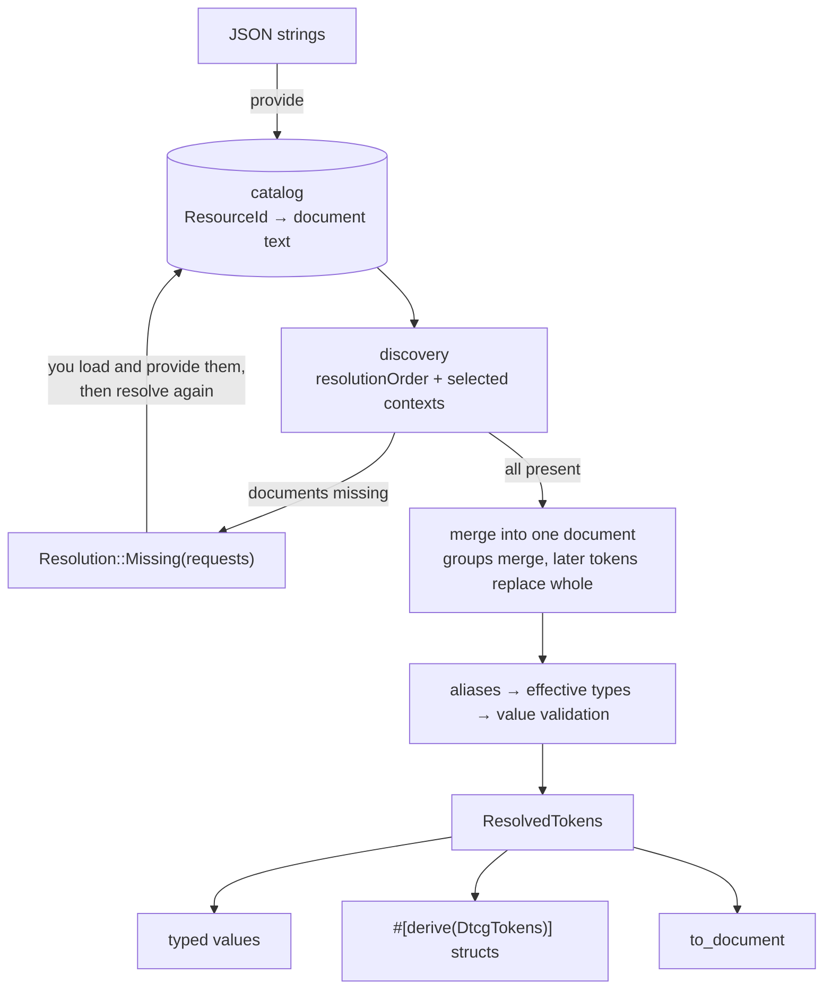

`dxn_dtcg` does no I/O. It stores JSON text under logical names, and when resolution reaches a document it does not have, it asks you for it instead of failing. This page explains that loop, the pipeline behind `resolve`, and what you can rely on.

## The resolve loop

Operations that need documents return `Result<Resolution<T>, DtcgError>`:

| Outcome | Meaning | What you do |
|---|---|---|
| `Ok(Resolution::Ready(value))` | Done | Use the value |
| `Ok(Resolution::Missing(requests))` | Documents are needed | Provide them and call again |
| `Err(error)` | The input is wrong or a limit was hit | Report it; retrying fails the same way |

Each `DocumentRequest` has the normalized `resource_id` to provide, the document it was `referenced_from` and the `original_reference` as written. A `Missing` response lists every document reachable in that pass, de-duplicated and sorted by id. A nested resolver can reveal more references once provided, which is why you loop until `Ready`.

## The pipeline

Every `resolve` call runs these stages from the catalog's current contents. Nothing is cached between calls.

1. **Discovery.** Walk `resolutionOrder` for the selected contexts, expanding set references, files, fragments and nested resolvers; collect missing documents.
2. **Merge and flatten.** Fold all active sources into one structure: groups merge member by member, a later token replaces an earlier one whole. Apply `$extends`, inherit `$type` and `$deprecated`, and list dotted token paths in a fixed order.
3. **Resolve.** Substitute aliases and JSON Pointers against the merged document, determine each token's effective type, detect cycles, enforce limits.
4. **Validate.** Check each resolved value against its DTCG type.
5. **Fingerprint.** SHA-256 over path, type, value and source of every token, in order.

Because aliases resolve after the merge, a theme only overrides the few palette tokens that differ and every semantic token that aliases them follows.

## Guarantees

- **Deterministic.** JSON member order is preserved, so token order is the authored order, never hash order. Missing-document requests are sorted. The same catalog, options and selection give the same result or the same error.
- **Bounded.** `RuntimeLimits` caps documents, reference depth, alias chains, copied JSON nodes and token count; value depth and path depth are fixed at 128. Hostile input ends in an error, not in a stack overflow. See [Limits and diagnostics](./limits.md).
- **Strict.** Unknown `$` properties, malformed tokens, unsupported types, wrong value shapes, aliases at disallowed positions and dangling references are errors. Errors name the document and token path.
- **Atomic catalog.** A failed `provide_json`, `replace_json` or batch leaves documents and revision as they were.
- **Thread-safe reads.** `DtcgRuntime`, `ResolvedTokens`, `ResolvedToken` and `DtcgError` are `Send + Sync`. Resolution takes `&self`, so threads can resolve against one runtime at once; mutation takes `&mut self`. Cloning a runtime is cheap because documents are `Arc<str>`.

## Caching is yours

Nothing is memoized, so a UI should cache. Two keys cover it: `runtime.catalog_revision()` changes on every successful catalog mutation, and `normalize_selection` turns equivalent selections (different case, defaults omitted) into one `Vec<(String, String)>`. The pair identifies a resolution exactly. To skip downstream work such as re-rendering, compare `ResolvedTokens::fingerprint()`. A cache is built in the [cookbook](./cookbook.md#cache-resolutions-per-theme).

Next: [Token documents](./token-documents.md), or jump to [Loading documents](./loading.md).
